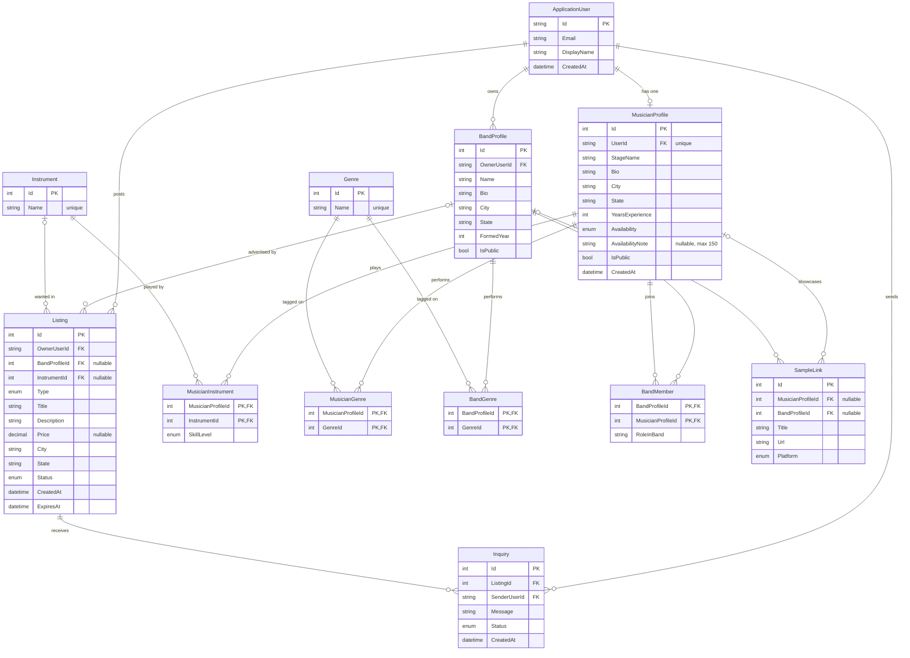

# Data Model: Musician Directory and Classifieds

Stack assumption: EF Core code-first, ASP.NET Core Identity, Blazor. Mermaid renders natively on GitHub, so this file can live in the repo as `docs/data-model.md`.

## ER Diagram

## Enums

| Enum | Values |
|---|---|
| Availability | OpenToWork, Limited, NotAvailable |
| SkillLevel | Beginner, Intermediate, Advanced, Professional |
| Listing.Type | BandSeekingMember, MusicianSeekingBand, GearForSale, LessonsOffered, GigOpening |
| Listing.Status | Active, Closed, Expired |
| SampleLink.Platform | YouTube, SoundCloud, Spotify, Bandcamp, Other |
| Inquiry.Status | New, Read, Replied, Archived |

## Rules and constraints

- **MusicianProfile.UserId** has a unique index (one profile per user).
- **Availability** is the "open to work" status. Show it as a text badge (not color alone) on directory cards and profiles, and offer it as a directory filter. New profiles default to OpenToWork. **AvailabilityNote** is an optional free-text line (max 150 chars) that says what the musician is open to, e.g. "Looking for a gigging cover band in the DFW area."
- **SampleLink** belongs to exactly one owner: add a check constraint so exactly one of `MusicianProfileId` / `BandProfileId` is non-null.
- **Instrument and Genre** are seeded lookup tables (HasData). Users pick from them, they do not create them. Keeps filtering clean.
- **Deletes:** cascade from Listing to Inquiry and from profiles to join tables and SampleLink. Set `Inquiry.SenderUserId` to Restrict (or ClientCascade) to avoid SQL Server multiple cascade path errors.
- **Authorization:** only the owner can edit or delete their profile, band, or listing. Only the listing owner can read its inquiries. Enforce in the service layer, not just by hiding buttons.
- **Privacy:** never display a user's email publicly. Contact happens through Inquiry.
- **SampleLink.Url:** store links only, validate the host against an allowlist (YouTube, SoundCloud, Spotify, Bandcamp), and embed with a sandboxed iframe. No file uploads, which keeps cloud cost and risk down.

## Additions beyond the original 8 entities

| Added | Why |
|---|---|
| MusicianInstrument | Many-to-many with SkillLevel on the join |
| MusicianGenre, BandGenre | Many-to-many join tables (can be EF skip navigations if no extra columns are wanted) |
| BandMember | Without it, a band is just a page owned by one user and cannot show its lineup |

## Suggested split of work (CRUD ownership)

| Area | Entities |
|---|---|
| Auth and users | ApplicationUser, Identity setup |
| Musician directory | MusicianProfile, MusicianInstrument, MusicianGenre, SampleLink |
| Bands | BandProfile, BandMember, BandGenre |
| Classifieds | Listing, Inquiry |
| Shared | Instrument, Genre seed data, layout, nav, accessibility pass |
